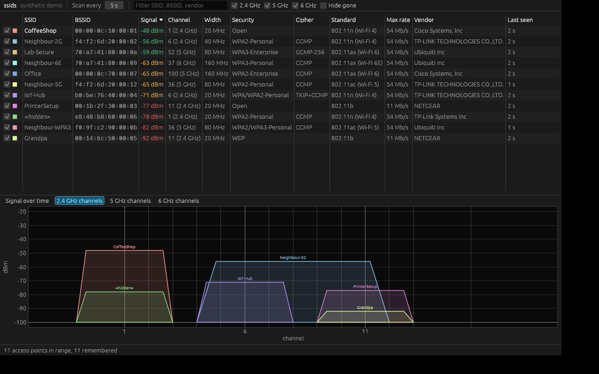

# ssids

A Wi-Fi scanner in Rust, inspired by [LinSSID](https://sourceforge.net/projects/linssid/):
a sortable table of nearby access points, signal strength over time, and
which channels each network occupies on 2.4, 5 and 6 GHz. It runs as a
native app on Linux and, via WebAssembly, in any modern browser.



This app was built with the help of Claude Sonnet 5.5 & Opus 5.5.

## What it shows

Per access point: SSID (hidden networks marked), BSSID, signal, channel and
band, channel width (20–320 MHz, 80+80), security (Open, WEP, WPA, WPA2,
WPA3, OWE, Personal/Enterprise) and ciphers, 802.11 standard / Wi-Fi
generation (including 6E and 7), highest legacy rate, vendor (IEEE OUI
registry) and how long ago it was heard. The connected network stands out:
its row is highlighted and bold, and the graphs draw it thicker with a bold
label.

Graphs: signal over the last five minutes, and per band an outline of each
AP over the spectrum it really occupies, so overlapping wide channels are
visible at a glance.


## Running it

```sh
cargo run --release -p ssids-ui            # GUI, live scanning (Linux)
cargo run --release -p ssids-ui -- --demo  # GUI on a synthetic neighbourhood, any OS
cargo run --release -p ssids-cli -- scan   # one scan as a table (or --json)
```

Options: `ssids-gui --interface wlan1`, `--replay FILE`, `--agent URL`;
`ssids record -o FILE` records scans for `--replay`.


### Scanning and privileges

Reading the kernel's scan results needs no privileges. Fresh scans have to
be *triggered*, which ssids tries in this order:

1. **nl80211 directly**: needs root or `CAP_NET_ADMIN`
   (`sudo setcap cap_net_admin+ep target/release/ssids-gui`);
2. **NetworkManager**: on desktops the logged-in user may request scans,
   so this usually works with no setup at all;
3. otherwise ssids shows what the system last cached and says so in the
   status bar (**Passive**). Results then refresh only when the system
   scans by itself.

ssids never needs to run as root and does not use `iw`/`iwlist`.


### In the browser

Browsers cannot access the Wi-Fi radio. The web build therefore shows the
synthetic demo, or live data from a local agent:

```sh
cargo install trunk
cd crates/ssids-ui && trunk build --release   # static site in crates/ssids-ui/dist
cargo run --release -p ssids-cli -- serve     # agent on ws://127.0.0.1:7878
# open the site with ?agent=ws://127.0.0.1:7878
```

`dist/` can be hosted anywhere static. Scan results reveal where a machine
is (BSSIDs are in public geolocation databases), so the agent listens on
loopback only and accepts browser pages only from allowed origins
(`--allow-origin`, default `http://127.0.0.1:8080` and
`http://localhost:8080`, i.e. `trunk serve`). Native clients such as
`ssids-gui --agent` send no origin and are accepted. Settings (interval,
filters, sort, graph) are remembered between runs in both builds.


## Architecture

Clean architecture as a Cargo workspace; dependencies point inward only.

```text
ssids-ui (egui: native + wasm)    ssids-cli (scan, record, serve)
        │   composition roots pick a ScanSource   │
        ▼                                         ▼
ssids-adapter-nl80211   ssids-adapter-replay   ssids-adapter-remote
 (Linux: nl80211 +       (recordings, demo)     (WebSocket client of
  NetworkManager)                                `ssids serve`)
        │ implement the ScanSource port             │
        ▼                                           ▼
ssids-app: ScanSource port, Session (cadence, retention, history)
        ▼
ssids-domain: Observation → AccessPoint (IE parser, channels, widths,
              security, vendors). Pure, no I/O, no clock.
```

- Adapters report raw `Observation`s; the information elements are parsed
  in exactly one place, `AccessPoint::from_observation`. Recordings and the
  agent's wire protocol carry the same raw observations.
- The domain and app layers have no I/O and receive time from the caller,
  so they are fully unit-tested without hardware and compile to
  `wasm32-unknown-unknown` unchanged (enforced in CI).
- Data from the air is untrusted: the parsers are total (truncated or
  malformed elements are skipped, never panicked on) and checked against
  generated inputs. A width claim that contradicts the primary channel is
  ignored.

Adding another platform means adding one adapter that produces
`Observation`s; nothing else changes.


## Development

```sh
scripts/ci.sh                       # fmt, clippy, tests, wasm32 clippy gate
cargo test -p ssids-adapter-nl80211 -- --ignored   # against real hardware
scripts/update-oui.py               # refresh the embedded IEEE OUI registry
scripts/make-demo-recording.py      # regenerate the synthetic demo
```

Rust 1.95 or newer. The test fixture `crates/ssids-domain/fixtures/*.hex`
is a real beacon captured with `ssids scan --json`.


## Not (yet) implemented

- Scan backends for macOS and Windows (they can use `--agent` or `--demo`).
- Choosing the interface inside the GUI (use `--interface`).
- CSV export (`ssids record` / `ssids scan --json` give the raw data).
- "Max rate" is the highest legacy rate, as in LinSSID, not the HT/VHT/HE
  PHY rate.
